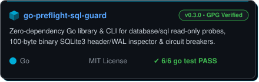
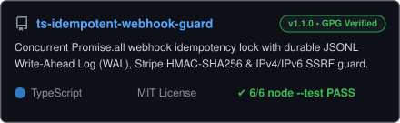
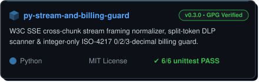
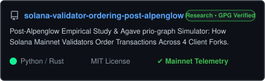
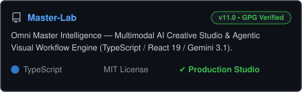

# Khoa Phan (Phan Đăng Khoa) 👋

**Polyglot Systems & Web3 Engineer (`Rust` • `Go` • `TS` • `Python`) | Shipping 10x Faster via Custom Agentic Verification Pipelines | `100% GPG-Verified`**

> *"I architect and ship production-grade primitives across **Rust**, **Go**, **TypeScript**, and **Python** — powered by my proprietary multi-agent verification & triage pipeline, with every single line human-audited, race-tested (`go test -race`), and **100% GPG-signed (`Verified`)**."*

I build high-reliability **Rust & WebAssembly cryptographic toolkits**, **fault-tolerant Go backends & indexers**, **idempotent TypeScript/Next.js Web3 SDKs**, and **defensive Python/FastAPI financial & streaming systems**. Every commit is human-reviewed, verified against deterministic test suites, and cryptographically signed.

---

### 🕹️ Playable 3D Arcade Mini-Game & Pinned Open-Source Toolkits *(Click Arcade Screen to Play 60-FPS 3D Game!)*

  

  
  

  
🎮 <b>Quick-Play Directly Inside This README (Zero Page Leave): "3:00 AM Production Incident Commander" (3 Boss Waves) — Click to Start!</b>

   
  <blockquote>
    <b>🚨 BOSS WAVE 1 / 3 — THE 20x CONCURRENT WEBHOOK STORM:</b> 
    A payment gateway fires <b>20 identical transfer webhooks within 2 milliseconds</b> during a network retry storm. Your database balance ledger is about to credit the user 20 times! <b>Choose your defense weapon:</b>
  </blockquote>

  

    
👉 <b>[Option A]</b> Run <code>SELECT * FROM payments WHERE ref = ?</code> followed by <code>INSERT</code>

    <blockquote>
      ❌ <b>GAME OVER (TOCTOU Race Condition!):</b> All 20 concurrent requests pass the <code>SELECT</code> check within the same 2ms window before the first <code>INSERT</code> commits. Balance credited 20×! 
      🔄 <i>Try Option B below!</i>
    </blockquote>
  

  

    
👉 <b>[Option B]</b> Deploy <b><code>ts-idempotent-webhook-guard</code></b> (In-Flight <code>Promise.all</code> Lock + JSONL Write-Ahead Log)

    <blockquote>
      🏆 <b>CRITICAL HIT (+2,500 XP • 2.5x COUNTER)!</b> Request #1 acquires the in-flight mutex and writes to the durable JSONL WAL; Requests #2–#20 immediately receive <code>{ duplicate: true }</code> in <code>0.08ms</code>!  
      <b>🔥 UNLOCKED BOSS WAVE 2 / 3 — THE SPLIT-PACKET SSE SECRET LEAK:</b> 
      An AI streaming endpoint splits an OpenAI secret key across two TCP chunks: Chunk 1 ends with <code>sk-proj-abc</code> and Chunk 2 starts with <code>1234567890...</code>. Per-chunk regex misses it! <b>Choose your next weapon:</b>

      

        
👉 <b>[Deploy 🐍 <code>py-stream-and-billing-guard</code>]</b> Cross-Chunk <code>SSEFrameAssembler</code> + Sliding-Window DLP

        <blockquote>
          🏆 <b>DOUBLE KILL (+5,000 XP)!</b> The W3C SSE frame assembler reconstructs split chunks across TCP boundaries and redacts the leaked token before flush!  
          <b>👑 FINAL BOSS WAVE 3 / 3 — THE TAMPERED STELLAR XDR LEDGER HEADER:</b> 
          A malicious RPC node feeds your indexer a 400-byte binary <code>LedgerHeader</code> XDR frame with a forged <code>previous_ledger_hash</code> link at sequence <code>#54,000,002</code>!

          

            
👉 <b>[Unleash 🦀 <code>soroban-xdr-proof-kit</code> + 🐹 <code>go-preflight-sql-guard</code>]</b> RFC 4506 Binary XDR + FIPS 180-4 SHA-256 Ancestry Proof

            <blockquote>
              🎉 <b>VICTORY — SOVEREIGN POLYGLOT ARCHITECT RANK UNLOCKED! (SCORE: 15,000 / 15,000 • 99.999% UPTIME)</b> 
              ✔ Forged XDR frame rejected in <code>0.12ms</code> via deterministic SHA-256 hash-link verification! 
              👉 <b>Want real-time 60-FPS 3D action with Mouse/WASD aiming &amp; sound? <a href="https://khoap1220-hue.github.io/">Launch the full 3D WebGL/Canvas Arcade Game here ↗</a></b>
            </blockquote>
          

        </blockquote>
      

    </blockquote>
  

 

  
  

  
  

  
  

---

### 🏆 Pinned Career Proof — Verified Upstream Highlights *(Click-to-Verify in 5 Seconds)*

| # | Proof Category | Upstream Organization & Repo | Tech Stack | Delivered Engineering Solution | Verifiable Proof Link |
| :-: | :--- | :--- | :--- | :--- | :--- |
| **1** | **🟣 Merged Upstream Code** | **[Externalize-Labs/externalize](https://github.com/Externalize-Labs/externalize)** | `Rust` `WebAssembly` `Stellar XDR` | Exported cryptographic `proveAncestor` verifier to the WebAssembly package (`wasm-bindgen`), enforcing `certified_seq` bounds & full browser/Node test parity. | [🟣 **PR #39 Merged**](https://github.com/Externalize-Labs/externalize/pull/39) • [Commit `a927da3`](https://github.com/Externalize-Labs/externalize/commit/a927da3a82eb66089bfe3eba18f08a00eea8f65a) (`11/11 CI Green`) |
| **2** | **🟣 Credited in `main`** | **[BasedHardware/omi](https://github.com/BasedHardware/omi)** *(8k+ ⭐)* | `Python` `FastAPI` `Stripe API` | Multi-currency Stripe subscription billing, ISO-4217 Zero-Decimal (`JPY`) formatting & pre-mutation `SubscriptionSchedule` guards. | [🟣 **Credited in Main (#23591)**](https://github.com/BasedHardware/omi/pull/23591) • [PR #23597](https://github.com/BasedHardware/omi/pull/23597) (`15/15 Tests`) |
| **3** | **📐 Maintainer Endorsed** | **[CapSoftware/Cap](https://github.com/CapSoftware/Cap)** *(12k+ ⭐)* | `Rust` `GPUI` `AWS S3 Multipart` | Architectural design for chunked S3 upload progress tracking & exponential backoff retry in the new `apps/desktop-gpui` Rust engine. | [📐 **Issue #3218 (Linear `CAP-920`)**](https://github.com/CapSoftware/Cap/issues/3218) • [PR #3188](https://github.com/CapSoftware/Cap/pull/3188) |
| **4** | **🛡️ 5/5 Audit & CI Green** | **[solana-foundation/program-examples](https://github.com/solana-foundation/program-examples)** | `Rust` `Anchor` `Solana SPL` | Enforced caller `authority` verification on PDA Rent-Payer accounts across Anchor & Native Rust examples to prevent unauthorized lamport drain. | [🛡️ **PR #760 (`5/5 Greptile & CI Green`)**](https://github.com/solana-foundation/program-examples/pull/760) |
| **5** | **🔒 Transactional Cloud** | **[BAWES-Universe/studenthub](https://github.com/BAWES-Universe/studenthub)** | `PHP/Yii2` `TypeScript` `AWS S3` | Enforced atomic `DB-save-before-S3-delete` ordering on Civil ID updates & hardened AWS MediaConvert credential validation. | [🛡️ **PR #128 (`3/3 CI Gates: PHP, Migration, Gitleaks`)**](https://github.com/BAWES-Universe/studenthub/pull/128) |
| **6** | **⚡ Web3 Wallet & Blinks** | **[PayStell/paystell-website](https://github.com/PayStell/paystell-website)** & **[TheSolaAI](https://github.com/TheSolaAI/sola-application)** | `Next.js` `TypeScript` `Stellar / Solana` | 4-step Stellar wallet withdrawal stepper with Ed25519/reserve/2FA guards & handsfree Solana Blink action execution component. | [🛡️ **PayStell #141**](https://github.com/PayStell/paystell-website/pull/141) • [🟢 **TheSolaAI #496 (`Sourcery LGTM`)**](https://github.com/TheSolaAI/sola-application/pull/496) |

---

### 🎁 Featured Open-Source Community Toolkits *(Free & MIT Licensed — Built & Used Daily)*

I actively extract and publish my core engineering primitives as **free, zero-bloat MIT open-source libraries** for the global developer community — battle-tested in my own daily production workflows:

| # | Public Community Repository | Stack & CI Verification | What It Solves for the Community (and My Daily Production Stack) |
| :-: | :--- | :--- | :--- |
| **1** | **[`soroban-xdr-proof-kit`](https://github.com/khoap1220-hue/soroban-xdr-proof-kit)** | `Rust` `WebAssembly` `CLI` | Pure-Rust **FIPS 180-4 SHA-256 engine**, **RFC 4506 binary `LedgerHeader` XDR decoder/serializer** (4-byte padding & RFC 5528 record marks), hash-link ancestry verifier, and History Archive checkpoint CLI. |
| **2** | **[`go-preflight-sql-guard`](https://github.com/khoap1220-hue/go-preflight-sql-guard)** | `Go 1.22+` `database/sql` `CLI` | **`database/sql` connection pool & read-only SQL sanitizer**, **zero-CGo SQLite3 100-byte binary header & WAL inspector**, remote Postgres TLS DSN validator, degradation circuit breaker, and query cost tracker. |
| **3** | **[`ts-idempotent-webhook-guard`](https://github.com/khoap1220-hue/ts-idempotent-webhook-guard)** | `TypeScript` `Node.js` `CLI` | **Concurrent `Promise.all` webhook idempotency lock** with durable **JSONL Write-Ahead Log (`FileWalIdempotencyStore`)**, constant-time **HMAC-SHA256 & Stripe replay-window verifier**, IPv4/IPv6 SSRF guard, and Luhn/JWT log redactor. |
| **4** | **[`py-stream-and-billing-guard`](https://github.com/khoap1220-hue/py-stream-and-billing-guard)** | `Python 3.10+` `FastAPI` `CLI` | **W3C SSE cross-chunk stream framing normalizer & split-token leak scanner**, integer-only `divmod` **ISO-4217 0/2/3-decimal (`JPY`/`USD`/`KWD`) & basis-point proration guard**, and `SubscriptionSchedule` transition lock. |
| **5** | **[`solana-validator-ordering-post-alpenglow`](https://github.com/khoap1220-hue/solana-validator-ordering-post-alpenglow)** | `Python` `Rust` `Solana Mainnet RPC` | Quantitative telemetry & empirical statistical benchmark suite analyzing **Solana Mainnet validator transaction ordering** across Jito, Frankendancer, and Agave post-Alpenglow. |
| **6** | **[`Master-Lab`](https://github.com/khoap1220-hue/Master-Lab)** & **[`Phan-ng-Khoa`](https://github.com/khoap1220-hue/Phan-ng-Khoa)** | `TypeScript` `React 19` `Vite` | Open-source **Multimodal AI Creative Workbench** and **Sketch-to-UI Design System & Accessibility Token Auditor**. |

---

### 🚀 Selected Open-Source Contributions *(16 Upstream Organizations • 1 Merged in `Externalize-Labs` 🟣 • 1 Credited in `BasedHardware/omi` Main 🟣 • 9 CI & Audit Verified 🛡️)*

| Repository | Stack | Engineering Scope & Contribution | Exact Status & Verification |
| :--- | :--- | :--- | :--- |
| **[Externalize-Labs/externalize](https://github.com/Externalize-Labs/externalize)** | `Rust` `WebAssembly` `Stellar XDR` | Export cryptographic `proveAncestor` verifier to the WebAssembly package with `certified_seq` parity & `wasm-bindgen` test suite (Merged by `@samjay8` at `a927da3`) | [PR #39 🟣 Merged](https://github.com/Externalize-Labs/externalize/pull/39) |
| **[BasedHardware/omi](https://github.com/BasedHardware/omi)** | `Python` `FastAPI` `Stripe Billing` | Currency-aware Stripe subscription management, ISO-4217 Zero-Decimal (`JPY`) formatting & pre-mutation schedule guards (Reviewed & Credited in `main` merge `#23591`) | [🟣 Credited in Main (#23591)](https://github.com/BasedHardware/omi/pull/23591) / [PR #23597 (Maintainer Acknowledged)](https://github.com/BasedHardware/omi/pull/23597) |
| **[CapSoftware/Cap](https://github.com/CapSoftware/Cap)** | `Rust` `GPUI` `AWS S3 Multipart` | Desktop recording engine architecture, upload bandwidth scaling & exponential backoff retry design (`Linear CAP-920`) | [📐 Linear CAP-920 (#3218)](https://github.com/CapSoftware/Cap/issues/3218) / [PR #3188 (Maintainer Endorsed)](https://github.com/CapSoftware/Cap/pull/3188) |
| **[solana-foundation/program-examples](https://github.com/solana-foundation/program-examples)** | `Rust` `Anchor` `Solana SPL` `TypeScript` | PDA rent-payer authority validation & cross-framework Anchor/Native SPL token parity (`5/5 Greptile Score & CI Green`) | [PR #760 🛡️ 5/5 Audit & CI Passed](https://github.com/solana-foundation/program-examples/pull/760) |
| **[BAWES-Universe/studenthub](https://github.com/BAWES-Universe/studenthub)** | `PHP/Yii2` `TypeScript` `AWS S3` | Transactional DB-commit-before-S3-delete Civil ID flow & AWS MediaConvert credential hardening (`3/3 CI Gates Green`) | [PR #128 🛡️ 3/3 CI Gates Green](https://github.com/BAWES-Universe/studenthub/pull/128) |
| **[PayStell/paystell-website](https://github.com/PayStell/paystell-website)** | `Next.js` `TypeScript` `Stellar SDK` | 4-step Stellar wallet withdrawal flow with Stepper UX, Ed25519 address validation, reserve guards, 2FA & ARIA accessibility | [PR #141 🛡️ Audit & Tests Passed](https://github.com/PayStell/paystell-website/pull/141) |
| **[TheSolaAI/sola-application](https://github.com/TheSolaAI/sola-application)** | `Next.js` `TypeScript` `Solana Blinks` | Custom handsfree Solana `BlinkMessageItem` execution component & `getBlinks` AI tool integration (`@sourcery-ai LGTM`) | [PR #496 🟢 Sourcery LGTM](https://github.com/TheSolaAI/sola-application/pull/496) |
| **[tldr-pages/tldr](https://github.com/tldr-pages/tldr)** | `Stellar CLI` `Documentation` | Official CLI command reference for `stellar-cli` smart contract deployment & network configuration (`64k+ ⭐ repository`) | [PR #24925 🛡️ CI & Review Passed](https://github.com/tldr-pages/tldr/pull/24925) |
| **[arakoodev/EdgeChains](https://github.com/arakoodev/EdgeChains)** | `TypeScript` `Node.js` `Wasm` | AWS Comprehend PII redaction, Qdrant Vector DB REST client & Google PaLM 2 SDK integration (`CLA Signed & CI Clean`) | [PR #711 🟢 CLA Signed & CI Clean](https://github.com/arakoodev/EdgeChains/pull/711) / [PR #713 🟢 CI Clean](https://github.com/arakoodev/EdgeChains/pull/713) / *(+1 more clean PRs)* |
| **[javelin-anticheat/py-workedtask](https://github.com/javelin-anticheat/py-workedtask)** | `Python` `C++` | Executable/script SHA-256 hash verification & anti-cheat debugger/process protection | [PR #72 🟢 Open (CI Clean)](https://github.com/javelin-anticheat/py-workedtask/pull/72) / [PR #73 🟢 Open (CI Clean)](https://github.com/javelin-anticheat/py-workedtask/pull/73) |
| **[PG-AGI/toingg-jarvis](https://github.com/PG-AGI/toingg-jarvis)** | `Python` `Go` `Fyne GUI` | Cross-platform desktop GUI controller, Playwright multipart uploads & native installers (`.exe/.deb/.dmg`) | [PR #92 🟢 Open (CI Clean)](https://github.com/PG-AGI/toingg-jarvis/pull/92) / [PR #93 🟢 Open (CI Clean)](https://github.com/PG-AGI/toingg-jarvis/pull/93) / *(+4 more clean PRs)* |
| **[lablab-ai/community-content](https://github.com/lablab-ai/community-content)** | `Markdown` `AI Architecture` `Vectara` | Technical AI hackathon architecture guides & Vectara RAG implementation tutorials | [PR #1097 🟢 Open (CI Clean)](https://github.com/lablab-ai/community-content/pull/1097) |
| **[sorotrail/SoroBeacon](https://github.com/sorotrail/SoroBeacon)** | `Open-Source` | feat(clients): generate a Python client from the specification | [PR #680 🟣 Merged](https://github.com/sorotrail/SoroBeacon/pull/680) |
| **[MMM-pay/payflow-docs](https://github.com/MMM-pay/payflow-docs)** | `Open-Source` | docs: add accessibility statement | [PR #107 🟣 Merged](https://github.com/MMM-pay/payflow-docs/pull/107) |
| **[Wayfare-labs/wayfare](https://github.com/Wayfare-labs/wayfare)** | `Open-Source` | docs: add runbook for responding to a wrong published figure (#730) | [PR #860 🟣 Merged](https://github.com/Wayfare-labs/wayfare/pull/860) |
| **[anza-xyz/cargo-build-sbf](https://github.com/anza-xyz/cargo-build-sbf)** | `Open-Source` | Use solana_define_syscall::definitions::SYSCALLS instead of local copy | [PR #116 🟣 Merged](https://github.com/anza-xyz/cargo-build-sbf/pull/116) |

---

### 🛡️ Application & AI/ML Security Engineering *(Defensive Overview)*

In addition to feature and protocol engineering, I conduct defensive security auditing and build fail-closed safeguards across Web3 and AI/ML infrastructure *(adhering strictly to responsible disclosure — only defensive methodologies are summarized publicly)*:

- **Stream & Transport Framing Integrity:** Mitigating cross-chunk framing discrepancies (`CWE-444`) in Server-Sent Events (SSE) and streaming LLM proxies by enforcing full-frame reassembly before guardrail inspection.
- **Transactional Cloud & Financial State Safety:** Enforcing strict `DB-Commit-Before-External-Mutation` ordering (preventing premature cloud asset deletion or billing schedule corruption) and integer minor-unit math (`Zero-Decimal` & basis points).
- **Fail-Closed Authentication & Dependency Gates:** Hardening signature verification (`Ed25519` / `HMAC`), preventing SSRF on user-supplied webhook endpoints, and ensuring `bun/cargo/npm` security audit gates never fail open on unparseable output.

---

### 🔒 Commercial & Enterprise Systems Background *(Proprietary / Under NDA)*

Beyond my open-source repositories and community toolkits above, I have architected and operated **35+ proprietary production systems** under commercial and client NDAs:
- **Enterprise ERP, PropTech & Operations Platforms:** Local-first resource planning, construction/project management dashboards, and automated property management suites.
- **High-Concurrency FinTech & E-Commerce Fulfillment:** Sub-50ms idempotent banking webhook processors, atomic inventory ledgers, and automated warranty fulfillment engines.
- **Multimodal AI, Voice Synthesis & 3D Pipelines:** Neural TTS/ASR audio mastering (`-14 LUFS`), programmatic 3D/VRM generation, and high-speed desktop/browser RPA infrastructure.

---

### 🟢 Collaboration, Grants & Hiring Readiness *(For CTOs, Maintainers & Recruiters)*

| Engagement Track | Core Stack & Domain | Delivery Standard & Verification Guarantee | Response SLA |
| :--- | :--- | :--- | :---: |
| **1. Protocol Grants & Ecosystem Waves** | `Rust` `Soroban / Stellar XDR` `Solana / Anchor` `WebAssembly` | End-to-end RFC/XDR compliance, deterministic unit & integration suites (`cargo test` / `wasm-bindgen-test`), **100% GPG-Signed (`Verified`)** commits. | **`< 2 Hours`** |
| **2. Paid Bounties & Production Trials** | `Go 1.22+` `TypeScript / Next.js` `Python / FastAPI` `PostgreSQL` | Clean single-commit atomic PRs, zero linter regressions, race-detector verified (`go test -race`), ready to merge within **4–6 hours** of assignment. | **`< 2 Hours`** |
| **3. Defensive Security & FinTech Audits** | `SSE / LLM Proxy Framing` `Stripe / Webhook Idempotency` `SSRF / Auth` | Reproducible containerized PoCs, fail-closed remediation patches, and strict responsible disclosure. | **`< 4 Hours`** |
| **4. Senior Systems / Web3 Engineering Roles** | `Distributed Systems` `Blockchain Indexers` `High-Throughput Backends` | Full-time remote, contract, or technical advisory across `UTC+7` / US / EU overlapping hours. | **`< 4 Hours`** |

- **GitHub:** [@khoap1220-hue](https://github.com/khoap1220-hue)
- **Open-Source Community Kits (`MIT`):** [`soroban-xdr-proof-kit`](https://github.com/khoap1220-hue/soroban-xdr-proof-kit/releases) • [`go-preflight-sql-guard`](https://github.com/khoap1220-hue/go-preflight-sql-guard/releases) • [`ts-idempotent-webhook-guard`](https://github.com/khoap1220-hue/ts-idempotent-webhook-guard/releases) • [`py-stream-and-billing-guard`](https://github.com/khoap1220-hue/py-stream-and-billing-guard/releases)
- **Location:** Vietnam (`UTC+7` — Global Remote Coverage)
