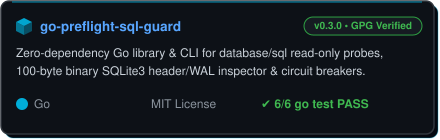
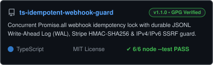
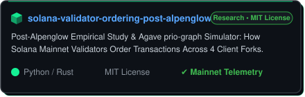
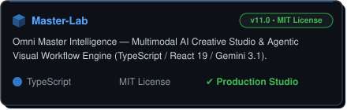

# Khoa Phan (Phan Đăng Khoa) 👋

**Independent Systems, Web3 & Custom MCP Engineer (`Rust` · `Go` · `TypeScript` · `Python`)**
**Former Head of R&D at APECGLOBAL Economic Group (2020–2023, past role)** · **21 Merged Upstream PRs** · **[`khoaphan.dev/services`](https://khoaphan.dev/services/?ref=gh-profile-readme)**

> **Async-Only Engineering Policy (100% Written Specs & GitHub PRs — No Live Meetings):** All engagements run **100% asynchronously via written specifications, reproducible clean-room PoCs, and GPG-signed pull requests** (`UTC+7` · `< 2h` written response).

[-$65--$145_Sprints-111827?style=flat-square)](https://contra.com/khoa_phan_abmwtndn)

---

### 🎅🍄 Super Mario Noel 3D Arcade & Pinned Open-Source Toolkits *(Click Arcade Screen to Play 60-FPS Holiday Game!)*

  

  
  
  

  
🎅 🎮 <b>Quick-Play Directly Inside This README (Zero Page Leave): "Super Mario Noel — World 12-25 Gift Rescue" (3 Holiday Stages) — Click to Start!</b>

   
  <blockquote>
    <b>❄️ STAGE 12-1 / 3 — THE SNOWY WARP PIPE &amp; 20x GOOMBA CLONE STORM:</b> 
    Santa Mario sprints across a snowy brick bridge as <b>20 cloned Goombas</b> burst out of a green Warp Pipe within 2ms! Above Mario gleams a golden <b><code>[?]</code> Noel Gift Block</b>. <b>Choose your move:</b>
  </blockquote>

  

    
👉 <b>[Option A]</b> Run straight forward on icy ground without jumping

    <blockquote>
      ❌ <b>MAMA MIA! (Lost Santa Cap!):</b> All 20 cloned Goombas collide at once before your jump frame commits! 
      🔄 <i>Try Option B below to jump &amp; bonk the <code>[?]</code> Gift Block!</i>
    </blockquote>
  

  

    
👉 <b>[Option B]</b> Jump &amp; Bonk <b><code>[?]</code> Gift Block</b> to unleash <b><code>ts-idempotent-webhook-guard</code></b> Star Lock!

    <blockquote>
      🍄 <b>1-UP + SUPER MUSHROOM (+2,500 PTS • 2.5x STOMP COMBO)!</b> Santa Mario bounces off Goomba #1 while the JSONL WAL Star Lock freezes Clones #2–#20 into harmless snowballs in <code>0.08ms</code>!  
      <b>🔥 UNLOCKED STAGE 12-2 / 3 — FROZEN BRIDGE &amp; SPLIT-ICICLE BARRAGE:</b> 
      Flying Paragoombas drop split-packet icicles across a snowy chasm hiding leaked API keys inside Christmas gift tags! <b>Grab your Holiday Power-Up:</b>

      

        
👉 <b>[Grab 🔥 <code>py-stream-and-billing-guard</code> Fire Flower]</b> Bouncing Fireballs + Cross-Chunk Holiday Tag Scanner

        <blockquote>
          🪙 <b>COIN FRENZY (+5,000 PTS • 🪙 ×99 NOEL COINS)!</b> Bouncing Mario Fireballs melt every icicle mid-air and safely seal all holiday gift tags!  
          <b>🎄 FINAL STAGE 12-25 / 3 — FROST KING CASTLE &amp; NORTH POLE STAR FLAGPOLE:</b> 
          Giant Frost-Koopa guards the snowy drawbridge right in front of the twinkling Christmas Tree &amp; North Pole Flagpole!

          

            
👉 <b>[Activate ⭐ Invincible Noel Star: 🦀 <code>soroban-xdr-proof-kit</code> + 🐹 <code>go-preflight-sql-guard</code>]</b> Triple Jump Over Boss &amp; Grab Top of Flagpole!

            <blockquote>
              🎆 <b>COURSE CLEAR — MERRY CHRISTMAS &amp; HAPPY HOLIDAYS! (SCORE: 15,000 / 15,000 • TOP OF THE FLAGPOLE +5,000!)</b> 
              ✔ Frost-Koopa flipped in <code>0.12ms</code> • Holiday Fireworks launched over the Cozy Noel Castle! 
              👉 <b>Want real-time 60-FPS Mario running, stomping, <code>[?]</code> Gift Blocks, snowfall &amp; 8-bit Jingle Bells audio? <a href="https://khoaphan.dev/arcade/">Play Super Mario Noel 3D Live on khoaphan.dev/arcade ↗</a></b>
            </blockquote>
          

        </blockquote>
      

    </blockquote>
  

 

  
  

  
  

  
  

---

### 1. Live Official Anthropic MCP Registry & Glama Servers (5 Active)

Production Model Context Protocol (`stdio` / JSON Schema 2020-12) servers published under `io.github.khoap1220-hue/*` and verified on Linux inspection containers:

| MCP Server & Source | Official Anthropic MCP Registry ID | Stack, Guardrails & Automated Tests | Glama Directory |
| :--- | :--- | :--- | :--- |
| **[`wakatime-mcp`](https://github.com/khoap1220-hue/wakatime-mcp)** | [`io.github.khoap1220-hue/wakatime-mcp`](https://registry.modelcontextprotocol.io/v0/servers?search=wakatime-mcp) | `Python` · Read-only personal coding telemetry, standup briefs, goals pace & config diagnostics | [Glama Listing ↗](https://glama.ai/mcp/servers/@khoap1220-hue/wakatime-mcp) |
| **[`caido-mcp`](https://github.com/khoap1220-hue/caido-mcp)** | [`io.github.khoap1220-hue/caido-mcp`](https://registry.modelcontextprotocol.io/v0/servers?search=caido-mcp) | `TypeScript` · 10 Caido HTTPQL/AppSec tools, `@caido/server-auth` PAT refresh, DLP redaction, `CAIDO_READ_ONLY=1` (`19/19` Vitest) | [Glama Listing ↗](https://glama.ai/mcp/servers/@khoap1220-hue/caido-mcp) |
| **[`shopnex-mcp`](https://github.com/khoap1220-hue/shopnex-mcp)** | [`io.github.khoap1220-hue/shopnex-mcp`](https://registry.modelcontextprotocol.io/v0/servers?search=shopnex-mcp) | `TypeScript` · ShopNex Admin API products, inventory, orders & analytics, `BigInt` integer cents, `SHOPNEX_READ_ONLY=1` (`15/15` Vitest) | [Glama Listing ↗](https://glama.ai/mcp/servers/@khoap1220-hue/shopnex-mcp) |
| **[`trefle-mcp`](https://github.com/khoap1220-hue/trefle-mcp)** | [`io.github.khoap1220-hue/trefle-mcp`](https://registry.modelcontextprotocol.io/v0/servers?search=trefle-mcp) | `Python` · Read-only Trefle botanical species search, growing-condition range filters & distribution zones (`10/10` pytest + subprocess handshake) | [Glama Listing ↗](https://glama.ai/mcp/servers/@khoap1220-hue/trefle-mcp) |
| **[`blender-mcp-suite`](https://github.com/khoap1220-hue/blender-mcp-suite)** | [`io.github.khoap1220-hue/blender-mcp-suite`](https://registry.modelcontextprotocol.io/v0/servers?search=blender-mcp-suite) | `Python` · 21 Blender 4.1+ 3D tools, `< 210ms` TCP socket auto-reconnect & Windows Job Object / POSIX zero-zombie containment (`76/76` tests) | [Glama Listing ↗](https://glama.ai/mcp/servers/@khoap1220-hue/blender-mcp-suite) |

---

### 2. Live Apify Store Actors, Commercial SDKs & GPG-Signed MIT GuardKits

| Category | Package / Store Listing | Stack | Engineering Scope & Verification |
| :--- | :--- | :--- | :--- |
| **Apify Store Actor** | **[`apify.com/khoaphan/eaa-accessibility-auditor`](https://apify.com/khoaphan/eaa-accessibility-auditor)** ([Source](https://github.com/khoap1220-hue/apify-eaa-accessibility-auditor)) | `Python` · `Apify SDK v3` | Directive (EU) 2019/882 (EAA), EN 301 549 & WCAG 2.2 AA e-commerce checkout readiness auditor for Apify, n8n & MCP |
| **Apify Store Actor** | **[`apify.com/khoaphan/b2b-contact-auditor`](https://apify.com/khoaphan/b2b-contact-auditor)** ([Source](https://github.com/khoap1220-hue/apify-b2b-contact-auditor)) | `Python` · `Apify SDK v3` | `robots.txt`-compliant B2B contact, tech-stack & `MX`/`SPF`/`DMARC` DNS deliverability auditor Actor |
| **n8n Community Node** | **[`n8n-nodes-wasphere`](https://github.com/khoap1220-hue/n8n-nodes-wasphere)** | `TypeScript` · `n8n` | Clean-room WaSphere WhatsApp Cloud & WA Server node with Dashboard Proxy auth, AI Agent tool mode & HMAC-SHA256 webhook trigger |
| **Official Python SDK** | **[`senddock-python`](https://github.com/khoap1220-hue/senddock-python)** · **[`SendDock/senddock-python#1`](https://github.com/SendDock/senddock-python/pull/1)** | `Python 3.9–3.13` | Typed Python SDK mirroring `@senddock/sdk` v0.2.0 one-to-one (`5/5` Python 3.9–3.13 CI matrix passing; upstream PR `#1`) |
| **Temporal Python SDK** | **[`workflowbuilder-temporal-py`](https://github.com/khoap1220-hue/workflowbuilder-temporal-py)** | `Python` · `Temporal` | Temporal Python SDK runner & Draft 2020-12 JSON Schema contract counterpart for `@workflowbuilder/temporal` (`#268`) |
| **MIT GuardKit (GPG)** | **[`soroban-xdr-proof-kit`](https://github.com/khoap1220-hue/soroban-xdr-proof-kit)** | `Rust` · `WebAssembly` | Zero-dependency FIPS 180-4 SHA-256 engine, RFC 4506 Stellar `LedgerHeader` binary XDR decoder & checkpoint ancestry CLI |
| **MIT GuardKit (GPG)** | **[`go-preflight-sql-guard`](https://github.com/khoap1220-hue/go-preflight-sql-guard)** | `Go 1.22+` · `CLI` | `database/sql` read-only startup probes, zero-CGo SQLite3 100-byte binary header/WAL inspector & query cost circuit breaker |
| **MIT GuardKit (GPG)** | **[`ts-idempotent-webhook-guard`](https://github.com/khoap1220-hue/ts-idempotent-webhook-guard)** | `TypeScript` · `ESM` | Concurrent `Promise.all` webhook idempotency lock with JSONL WAL persistence, constant-time HMAC/Stripe verifier & SSRF/DLP guards |
| **MIT GuardKit (GPG)** | **[`py-stream-and-billing-guard`](https://github.com/khoap1220-hue/py-stream-and-billing-guard)** | `Python` · `FastAPI` | W3C SSE cross-chunk stream framing normalizer, split-token leak scanner & integer-only ISO-4217 (`0`/`2`/`3`-decimal) billing guard |
| **MIT Research Suite** | **[`solana-validator-ordering-post-alpenglow`](https://github.com/khoap1220-hue/solana-validator-ordering-post-alpenglow)** | `Python` · `Rust` | Quantitative telemetry & statistical benchmark analyzing Solana Mainnet validator ordering post-Alpenglow |
| **MIT Creative Engine** | **[`Master-Lab`](https://github.com/khoap1220-hue/Master-Lab)** | `TypeScript` · `React 19` | Open-source Multimodal AI Creative Workbench and Agentic Visual Workflow Engine (`MIT` licensed) |

---

### 3. Async Engineering Sprints (`0%`-Fee Escrow · 100% Written Specs, No Live Meetings)

Fixed-scope deliverables shipped asynchronously from written specs with automated unit tests, GPG-signed commits, and a **30-day bug warranty**:

| Sprint Package | Fixed Price | Turnaround | Deliverable & Acceptance Criteria | Direct Booking (`0%`-Fee Escrow) |
| :--- | :---: | :---: | :--- | :--- |
| **48h Starter Fix** | **`$65`** | `48 Hours` | 2-tool MCP endpoint, webhook/API bugfix, or EAA / WCAG 2.2 HTML, ARIA & checkout remediation with regression tests | [Book `$65` Sprint on Contra ↗](https://contra.com/s/lUkcc27W-48-hour-starter-milestone-2-tool-mcp-api-or-webhook-fix) · [Details ↗](https://khoaphan.dev/services/?ref=gh-profile-readme) |
| **Automation, SDK or Scraper** | **`$120`** | `3 Days` | Typed Python/TS SDK, fault-tolerant Playwright/Apify Actor, n8n node, or replay-safe FastAPI webhook + `--json` CLI harness | [Book `$120` Sprint on Contra ↗](https://contra.com/s/W6QZAcEB-python-sdk-playwright-scraper-or-fast-api-webhook-integration) · [Contra Profile ↗](https://contra.com/khoa_phan_abmwtndn) |
| **Custom MCP Server** | **`$145`** | `3–5 Days` | Schema-validated `stdio` / Streamable HTTP MCP server for Claude, Cursor & VS Code with zero-zombie containment & DLP guards | [Book `$145` MCP on Contra ↗](https://contra.com/s/Ll3krLoU-custom-mcp-server-for-claude-desktop-cursor-and-ai-agents) · [All Packages ↗](https://khoaphan.dev/services/?ref=gh-profile-readme) |
| **Webhook & Contract Audit** | **`$350+`** | `5–7 Days` | TOCTOU payment idempotency, HTTP 402 (`x402`) nonce state-machine & Rust/Soroban/Clarity 128-bit smart contract remediation | [Services Catalog ↗](https://khoaphan.dev/services/?ref=gh-profile-readme) · [Email Written Scope ↗](mailto:khoa@khoaphan.dev) |

- **Services Catalog & Architecture Briefs:** [`https://khoaphan.dev/services/?ref=gh-profile-readme`](https://khoaphan.dev/services/?ref=gh-profile-readme)
- **Contra Storefront (`0%` Commission Escrow):** [`https://contra.com/khoa_phan_abmwtndn`](https://contra.com/khoa_phan_abmwtndn)
- **Workflow:** `100%` written specs, async chat/email (`khoa@khoaphan.dev`), bounded upfront PoCs when needed, and clean GitHub pull requests (no live meetings).

---

### 🚀 Selected Open-Source Contributions *(18 Upstream Organizations • 21 Merged Upstream PRs 🟣 • 1 Credited in `BasedHardware/omi` Main 🟣 • Active Open PRs In Review 🟡)*

| Repository | Stack | Engineering Scope & Contribution | Exact Status & Verification |
| :--- | :--- | :--- | :--- |
| **[Externalize-Labs/externalize](https://github.com/Externalize-Labs/externalize)** | `Rust` `WebAssembly` `Stellar XDR` | Export cryptographic `proveAncestor` verifier to the WebAssembly package (`wasm-bindgen`) with `certified_seq` parity (Merged at `a927da3`, 11/11 CI Green) | [PR #39 🟣 Merged](https://github.com/Externalize-Labs/externalize/pull/39) |
| **[anza-xyz/cargo-build-sbf](https://github.com/anza-xyz/cargo-build-sbf)** | `Rust` `Solana SBF` `Compiler Tooling` | Consolidate `solana_define_syscall::definitions::SYSCALLS` directly into Anza's Solana SBF build toolchain instead of maintaining local copies | [PR #116 🟣 Merged](https://github.com/anza-xyz/cargo-build-sbf/pull/116) |
| **[solana-foundation/program-examples](https://github.com/solana-foundation/program-examples)** | `Rust` `Anchor` `Solana SPL` | Mandatory caller `authority` verification notes on PDA Rent-Payer examples across Anchor & Native Rust (Merged at `a9446bc`, `5/5 Greptile`) | [PR #760 🟣 Merged](https://github.com/solana-foundation/program-examples/pull/760) |
| **[Altacon-Labs/RevMarket](https://github.com/Altacon-Labs/RevMarket)** | `Node.js / ESM` `SQLite` `Stellar Soroban` | Durable SQLite checkpoint market event indexer (`#42`), verified on-chain wallet activity separation (`#56`), and trusted-proxy rate limiting (`#57`) | [PR #42 🟣 Merged](https://github.com/Altacon-Labs/RevMarket/pull/42) / [PR #56 🟣 Merged](https://github.com/Altacon-Labs/RevMarket/pull/56) / [PR #57 🟣 Merged](https://github.com/Altacon-Labs/RevMarket/pull/57) |
| **[sorotrail/SoroBeacon](https://github.com/sorotrail/SoroBeacon)** | `Python` `OpenAPI` `Stellar RPC` | Generate a typed Python client SDK directly from the SoroBeacon OpenAPI specification | [PR #680 🟣 Merged](https://github.com/sorotrail/SoroBeacon/pull/680) |
| **[tldr-pages/tldr](https://github.com/tldr-pages/tldr)** | `Stellar CLI` `Documentation` | Standardized cross-platform CLI command reference for `stellar-cli` smart contract deployment & network configuration (`64k+ ⭐ repository`) | [PR #24925 🟣 Merged](https://github.com/tldr-pages/tldr/pull/24925) |
| **[ritik4ever/stellar-stream](https://github.com/ritik4ever/stellar-stream)** | `TypeScript` `ARIA / A11y` `Stellar` | ARIA accessibility audit helpers and keyboard navigation fixes across interactive Stellar payment streaming components | [PR #1436 🟣 Merged](https://github.com/ritik4ever/stellar-stream/pull/1436) |
| **[Farm-credit/stellar-app-os](https://github.com/Farm-credit/stellar-app-os)** | `TypeScript` `State Safety` `API` | Guarded `localStorage` IANA timezone validation (`#1797`), planting partner certifications (`#1798`), and IUCN species prioritisation (`#1799`) | [PR #1797 🟣 Merged](https://github.com/Farm-credit/stellar-app-os/pull/1797) / [PR #1798 🟣 Merged](https://github.com/Farm-credit/stellar-app-os/pull/1798) / [PR #1799 🟣 Merged](https://github.com/Farm-credit/stellar-app-os/pull/1799) |
| **[ritik4ever/stellar-goal-vault](https://github.com/ritik4ever/stellar-goal-vault)** | `TypeScript` `API Filtering` `Metrics` | Multi-facet campaign sorting (`#1377`), side-by-side campaign comparison metrics (`#1378`), and category discovery helpers (`#1379`) | [PR #1377 🟣 Merged](https://github.com/ritik4ever/stellar-goal-vault/pull/1377) / [PR #1378 🟣 Merged](https://github.com/ritik4ever/stellar-goal-vault/pull/1378) / [PR #1379 🟣 Merged](https://github.com/ritik4ever/stellar-goal-vault/pull/1379) |
| **[Wayfare-labs/wayfare](https://github.com/Wayfare-labs/wayfare)** | `Operations SRE` `Runbooks` | Operational incident response runbook for correcting published corridor telemetry figures | [PR #860 🟣 Merged](https://github.com/Wayfare-labs/wayfare/pull/860) |
| **[MMM-pay/payflow-docs](https://github.com/MMM-pay/payflow-docs)** | `WCAG A11y` `Documentation` | Accessibility compliance statement and keyboard/screen-reader navigation documentation | [PR #107 🟣 Merged](https://github.com/MMM-pay/payflow-docs/pull/107) |
| **[BasedHardware/omi](https://github.com/BasedHardware/omi)** | `Python` `FastAPI` `Stripe Billing` | ISO-4217 Zero-Decimal (`JPY`) subscription plan-change boundary test coverage acknowledged during review of `main` merge `#23591` (`8k+ ⭐`) | [🟣 Credited in Main (#23591)](https://github.com/BasedHardware/omi/pull/23591) |
| **[aibtcdev/x402-api](https://github.com/aibtcdev/x402-api)** | `TypeScript` `Cloudflare DO` `sBTC / x402` | Migrate HTTP 402 payment middleware and Durable Object polling engine to strict `X402_RELAY` RPC bindings with 3-stage validation | [PR #150 🟡 Open In Review](https://github.com/aibtcdev/x402-api/pull/150) |
| **[wraith-protocol/contracts](https://github.com/wraith-protocol/contracts)** | `Rust` `Nervos CKB` `Fuzzing` | Malformed-witness and type-script adversarial fuzz corpus for contract verification | [PR #285 🟣 Merged](https://github.com/wraith-protocol/contracts/pull/285) |
| **[Miracle656/veil](https://github.com/Miracle656/veil)** | `TypeScript` `React Native` `WebAuthn PRF` | Four notification categories with server sync, passkey PRF claim onboarding, and claim link expiry sweeps | [PR #1353 🟡 Open In Review](https://github.com/Miracle656/veil/pull/1353) / [PR #1356 🟡 Open In Review](https://github.com/Miracle656/veil/pull/1356) / [PR #1357 🟡 Open In Review](https://github.com/Miracle656/veil/pull/1357) / *(+1 more open PRs)* |
| **[Lelu-ai/lelu](https://github.com/Lelu-ai/lelu)** | `Open-Source` | feat(sdk-python): send confidence_signal and add signal_from builders | [PR #160 🟣 Merged](https://github.com/Lelu-ai/lelu/pull/160) |
| **[zkpayroll/zk-payroll-dashboard](https://github.com/zkpayroll/zk-payroll-dashboard)** | `Open-Source` | feat(archive): disable retention purge while settlement is pending (#859) | [PR #977 🟣 Merged](https://github.com/zkpayroll/zk-payroll-dashboard/pull/977) |
| **[wraith-protocol/www](https://github.com/wraith-protocol/www)** | `Open-Source` | feat(test): add route-level visual regression coverage across locales and themes (#220) | [PR #231 🟣 Merged](https://github.com/wraith-protocol/www/pull/231) |

---

### 🛡️ Application & AI/ML Security Engineering *(Defensive Overview)*

In addition to feature and protocol engineering, I conduct defensive security auditing and build fail-closed safeguards across Web3 and AI/ML infrastructure *(adhering strictly to responsible disclosure — only defensive methodologies are summarized publicly)*:

- **Stream & Transport Framing Integrity:** Mitigating cross-chunk framing discrepancies (`CWE-444`) in Server-Sent Events (SSE) and streaming LLM proxies by enforcing full-frame reassembly before guardrail inspection.
- **Transactional Cloud & Financial State Safety:** Enforcing strict `DB-Commit-Before-External-Mutation` ordering (preventing premature cloud asset deletion or billing schedule corruption) and integer minor-unit math (`Zero-Decimal` & basis points).
- **Fail-Closed Authentication & Dependency Gates:** Hardening signature verification (`Ed25519` / `HMAC`), preventing SSRF on user-supplied webhook endpoints, and ensuring `bun/cargo/npm` security audit gates never fail open on unparseable output.

---

- **Flagship Hub & Holiday 3D Arcade:** [`https://khoaphan.dev`](https://khoaphan.dev) · **Play Super Mario Noel 3D:** [`https://khoaphan.dev/arcade/`](https://khoaphan.dev/arcade/)
- **Services:** [`khoaphan.dev/services/`](https://khoaphan.dev/services/?ref=gh-profile-readme) · **Engineering Notes:** [`khoaphan.dev/writing/`](https://khoaphan.dev/writing/) · **Printable CV:** [`khoaphan.dev/resume/`](https://khoaphan.dev/resume/)
- **Direct Contact:** [`khoa@khoaphan.dev`](mailto:khoa@khoaphan.dev) · **Location:** Ho Chi Minh City, Vietnam (`UTC+7` — Global Async Coverage)
